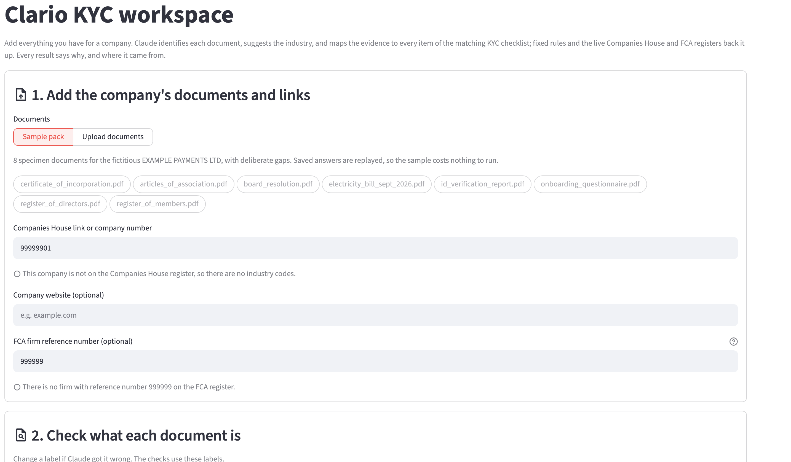
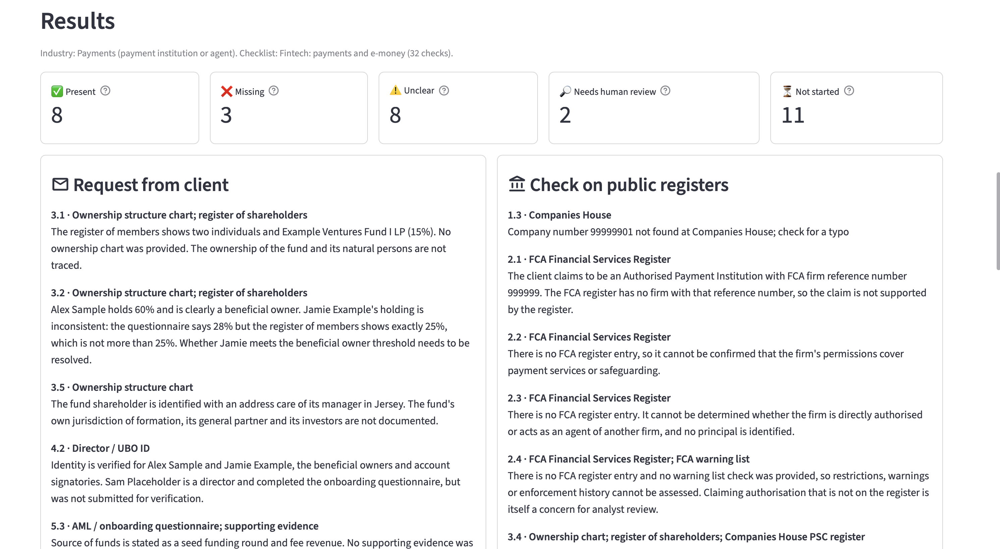
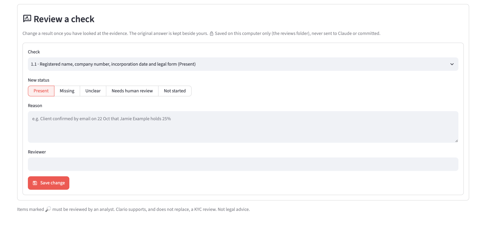

# Clario: KYC document intelligence for UK onboarding

Clario reviews a company's KYC (know your customer) pack the way an onboarding analyst would. You drop in every document you have for a company and add its full legal name, Companies House number, FCA firm reference number and website. Clario then:

1. **checks the legal entity name** against Companies House;
2. **identifies each document** (certificate of incorporation, proof of address, shareholder register and so on);
3. **works out the industry** from the questionnaire, the official industry codes and the FCA register;
4. **suggests an initial risk rating** (Low, Medium or High) from the ownership and business documents and the registers; the analyst confirms or overrides it, and it **picks the checklist**: simplified, standard or enhanced due diligence for that industry;
5. **checks the pack against every item on that checklist**, showing what is present, what is missing and what doesn't add up, with a quote and page reference for every finding;
6. lets **an analyst validate the checklist line by line**, confirming or overriding each result.

The output is the "request from client" list and the "check on public registers" list an analyst would otherwise build by hand.



## What it catches

The sample pack is a fictitious company, EXAMPLE PAYMENTS LTD, with problems planted on purpose. Clario finds them:

| Planted problem | What Clario reports |
|---|---|
| The questionnaire claims FCA authorisation under firm reference number 999999 | **2.1 Unclear:** the FCA register has no firm with that number, so the claim is not supported. Permissions (2.2) and enforcement history (2.4) are **Missing**. |
| The company number is not on Companies House | **1.3 Unclear:** company not found at Companies House |
| A shareholder holds 25% in the register but 28% in the questionnaire | **3.2 Unclear**, quoting both documents |
| No ownership structure chart | **3.1 Missing**, added to the "request from client" list |
| One director has no identity check | **4.2 Needs human review** |



## How it works

```
Documents (PDF or photo) ─┐
Companies House record ───┤  Claude: what is each document?  →  analyst confirms the labels
FCA register entry ───────┤  Claude: which industry?         →  analyst confirms the industry and checklist
Company website ──────────┘  Claude: evidence for every check, quoted with document and page
                                          │
                     fixed rules re-decide the legal-existence checks (1.1 to 1.4)
                                          │
                       results  →  analyst overrides, saved with reason, name and date
```

- **AI where judgement is needed, rules where it isn't.** Claude reads documents and maps evidence. Deterministic Python rules check the legal entity name against Companies House, the company number format, document dates, the 3-month age limit for proof of address, name matches, and the live Companies House status. Where the rules decide, Claude's view is still shown beside them.
- **Every finding is traceable.** Each result says who decided it (rules, Claude or a named analyst) and quotes its evidence with document name and page.
- **Statuses describe the evidence, not the customer.** Present, Missing, Unclear and Needs human review come from the checklist itself. Clario never approves or rejects a client; red flags go to an analyst.
- **Eighteen checklists.** Fintech (payments and e-money), general business, crypto, lending, investment firm and asset management, each at Low, Medium and High risk. The confirmed industry and risk rating set one, and the analyst can choose another. The Medium checklists were approved by a compliance professional on 26 Oct 2026; the Low and High versions were reviewed on 31 Oct 2026.
- **Live public registers.** Companies House (company profile, officers, persons with significant control and SIC industry codes) and the FCA Financial Services Register (status, every permission, requirements, disciplinary history and approved individuals). The page warns straight away if the FCA's record links the firm to a different company number.
- **Drafts.** A review can be saved as a draft and continued later: add or remove documents, edit details, and pick up where you left off. Claude's answers are kept with the draft, so reopening it costs nothing.
- **Risk-based checklists.** Before the checklist, Claude rates customer, product, geography and delivery channel risk against a methodology spreadsheet (`docs/UK_KYC_Risk_Methodology.xlsx`, reviewed on 31 Oct 2026) and flags enhanced due diligence triggers, with evidence. Fixed rules combine them: any trigger means High, otherwise the highest factor wins. The analyst confirms the rating, or overrides it with a signed-off reason. Every review ends with final approval by senior management. The rating picks the checklist: each industry has Low (simplified), Medium (standard) and High (enhanced due diligence) versions, 18 in all. Clario never approves or declines a client.
- **Line-by-line validation.** The analyst ticks each checklist line as validated, or changes its status with a required note. Every line records who validated it and when, keeps the original answer, can be undone, and is saved on the analyst's own machine.

## Design choices

- **Structured outputs.** Claude answers in a fixed JSON format, so every reply can be read by code and an unexpected answer falls back safely (for example to "Unclear" or "Other").
- **Prompt-injection guard.** Uploaded documents and web pages are treated as information to read, never as instructions to follow.
- **Cost control.** Each Claude call shows its cost on the page. Only the documents that describe the business are sent for the industry question. Answers are saved against a fingerprint of the exact input (documents, labels, links and checklist questions), so a demo replays for free and an answer is never reused for different input.
- **Privacy.** Uploaded files are sent to Anthropic to be read, so the page says to use only fictitious or approved documents. API keys live only in a git-ignored `.env`, and analyst notes and drafts stay in the git-ignored `reviews/` and `cases/` folders.

### Measured cost per company

| Step | Cost |
|---|---|
| Identify the documents (8 files) | about $0.09 |
| Suggest the industry | about $0.03 |
| Map the evidence to the checklist | about $0.21 |
| Suggest the initial risk rating | about $0.10 |
| **Total** | **about $0.43 (roughly 34p)** |

Companies House and FCA register lookups are free. The sample pack replays saved answers and costs nothing.



## Run it yourself

You need Python 3.12 or later and three free or low-cost keys: a [Companies House API key](https://developer.company-information.service.gov.uk/), an [FCA Register API key](https://register.fca.org.uk/Developer/s/) and an [Anthropic API key](https://console.anthropic.com/).

```bash
python3 -m venv .venv
.venv/bin/pip install -r requirements.txt
cp .env.example .env          # then open .env and fill in your keys
.venv/bin/streamlit run app/main.py
```

The sample pack needs the Companies House and FCA keys (both free) but no Anthropic key, because Claude's answers for it are saved. To run the tests (they never go online or spend money):

```bash
.venv/bin/python -m pytest
```

## Project layout

| Path | What it holds |
|---|---|
| `app/main.py` | Starts the app and shows the menu |
| `app/app_pages/home.py` | The landing page: what Clario does and what you get |
| `app/app_pages/review.py` | The review page: entity details, documents, checks and results |
| `services/pack.py` | Document identification and evidence mapping for the whole checklist |
| `services/industry.py` | Industry suggestion and the industry-to-checklist link |
| `services/validator.py` | The fixed rules for the legal-existence checks |
| `services/companies_house.py`, `services/fca.py`, `services/website.py` | Live sources |
| `services/risk.py` | Initial risk rating: the methodology, Claude's factor ratings and the fixed rules |
| `services/reviews.py` | Analyst overrides, saved per case |
| `services/cases.py` | Draft reviews: details, documents and saved answers |
| `services/extractor.py` | Calls to Claude, saved answers and cost |
| `docs/*.xlsx` | The 18 checklists (`scripts/make_industry_checklists.py` and `scripts/make_risk_level_checklists.py` build them) and the risk methodology |
| `sample_documents/` | The fictitious sample pack and its saved answers |
| `data/sic_codes.csv` | Official SIC industry code descriptions |
| `tests/` | Tests, using fake versions of Claude and the registers |

## Limits

Clario supports a KYC review and does not replace one. It does not run sanctions, PEP or adverse media screening (those checks are left as "Not started" for a screening tool), and it suggests, but does not make, the risk decision. It is not legal advice.

## Built with

Python, [Streamlit](https://streamlit.io), the [Anthropic API](https://docs.anthropic.com) (Claude Opus 5.5), openpyxl, fpdf2 and pytest. Company data comes from the Companies House API and FCA register data from the FCA Financial Services Register API. SIC code descriptions are from Companies House's public list ([api-enumerations](https://github.com/companieshouse/api-enumerations)). Public sector information is licensed under the Open Government Licence v3.0.
