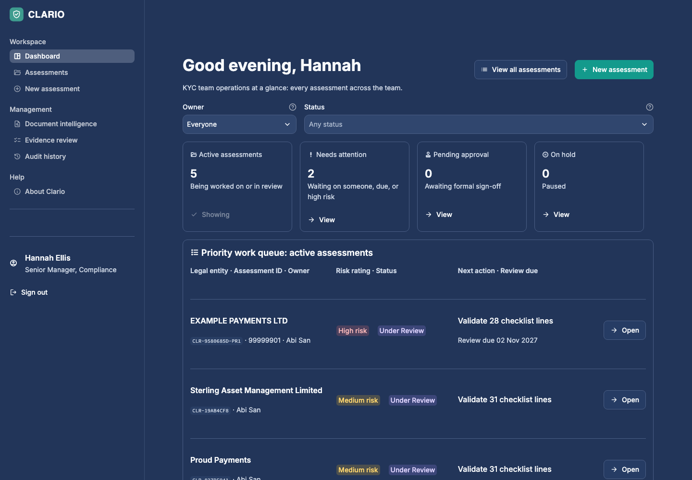
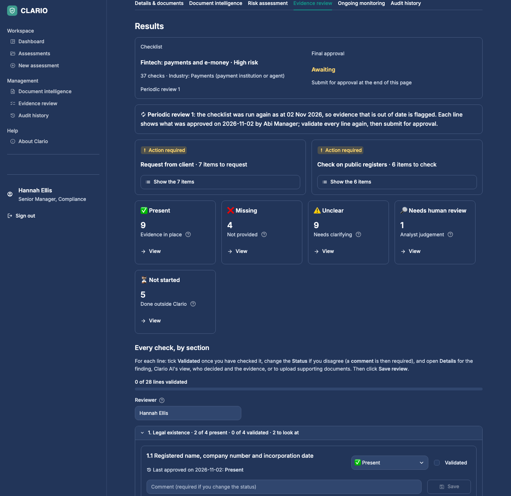
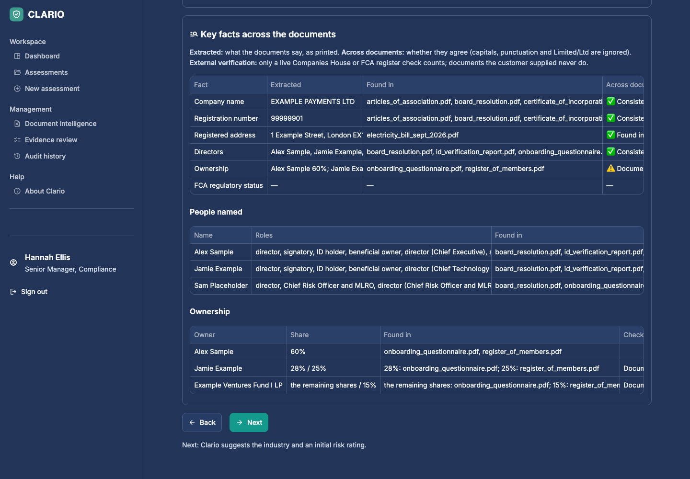
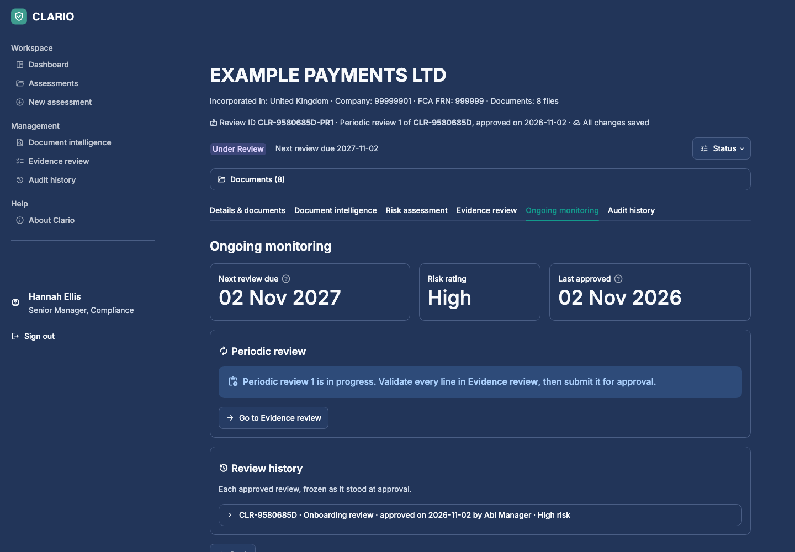

# Clario: KYC document intelligence for UK onboarding

Clario is an internal workspace for a KYC (know your customer) team onboarding UK financial services clients. An analyst adds a company's details and documents; Clario identifies each document, extracts the key facts, checks them against Companies House and the FCA register, suggests an industry and a risk rating, and checks the whole pack against a risk-based checklist. The analyst validates every line, submits the review, and senior management approves it. Approved reviews are frozen, then reviewed again on a schedule set by the risk rating.



## The workflow

1. **Details and documents.** The legal entity's name, country of incorporation, Companies House number, FCA firm reference number and website, the firm's own customer reference and the customer type, and its documents: PDFs, Word, Excel, CSV, text files, emails, web pages or photos. The name is checked against Companies House as you type. Non-UK entities skip the UK register checks.
2. **Document intelligence.** Clario identifies each document (certificate of incorporation, register of members, proof of address and so on) and extracts the company name, registration number, registered address, dates, people and owners from each one. It compares them across documents and flags where they disagree. The analyst corrects any document type, with a comment.
3. **Risk assessment.** Clario suggests the industry and an initial risk rating (Low, Medium or High) from the ownership and business documents and the registers, against a risk methodology, and flags enhanced due diligence triggers. The analyst confirms or overrides; an override needs a reason, sign-off from an AML senior officer and evidence. The industry and rating pick the checklist: simplified, standard or enhanced due diligence.
4. **Evidence review.** Every checklist line shows its status (Present, Missing, Unclear, Needs human review, Not started), the finding, the evidence quoted with document and page, and who decided it. The analyst validates line by line, changes a status with a comment, or uploads a supporting document, which Clario reads against that line. The "request from client" and "check on public registers" lists are built automatically.
5. **Submit and approve.** Once every line is Present and validated, the analyst submits the review; only then can senior management approve or reject it. Approval freezes the checklist, with a copy of every document used.
6. **Ongoing monitoring.** The next review date follows the risk rating (1, 2 or 3 years). A periodic review runs the checklist again as at its start date, flags any evidence that is out of date and no longer valid, and shows what was approved last time beside every line, each of which must be validated again. It has its own ID linked to the original (e.g. `CLR-9580685D-PR1`), and goes through submission and approval in turn. Every approved review stays in the review history.

Every change, by a person or by Clario, is recorded in the assessment's audit history.



## What it catches

The example case is a fictitious company, EXAMPLE PAYMENTS LTD, with problems planted on purpose. Clario finds them:

| Planted problem | What Clario reports |
|---|---|
| The questionnaire claims FCA authorisation under firm reference number 999999 | **2.1 Unclear:** the FCA register has no firm with that number, so the claim is not supported. Permissions (2.2) and enforcement history (2.4) are **Missing**. |
| The company number is not on Companies House | **1.3 Unclear:** company not found at Companies House |
| A shareholder holds 25% in the register but 28% in the questionnaire | **3.2 Unclear**, quoting both documents |
| No ownership structure chart | **3.1 Missing**, added to the "request from client" list |
| One director has no identity check | **4.2 Needs human review** |



## How it works

```
Documents (PDF, Word, ...)┐
Companies House record ───┤  Claude: what is each document, and what does it show?  →  analyst confirms
FCA register entry ───────┤  Claude: which industry, and what risk rating?           →  analyst confirms or overrides
Company website ──────────┘  Claude: evidence for every check, quoted with document and page
                                          │
                     fixed rules re-decide the legal-existence checks and combine the risk factors
                                          │
          analyst validates every line  →  submits  →  senior management approves  →  frozen record
                                          │
                          next review date  →  periodic review: checklist runs again, out-of-date evidence flagged
```

- **AI where judgement is needed, rules where it isn't.** Claude reads documents and maps evidence. Deterministic Python rules check the entity name against Companies House, the company number and its live status, document dates, the age of proof of address, and how the risk factors combine (any enhanced due diligence trigger means High, otherwise the highest factor wins). Comparing facts across documents is a rule too.
- **Every finding is traceable.** Each line says who decided it (rules, Clario AI or a named analyst) and quotes its evidence with document name and page. Approved records show what Clario found and what the analyst wrote, side by side.
- **Clario never approves a client.** Statuses describe the evidence, not the customer. Analysts validate, senior management approves, and red flags go to a person.
- **Eighteen checklists.** Fintech (payments and e-money), general business, crypto, lending, investment firm and asset management, each at Low, Medium and High risk. The Medium checklists were approved by a compliance professional on 26 Oct 2026; the Low and High versions and the risk methodology were reviewed on 31 Oct 2026.
- **Live public registers.** Companies House (company profile, officers, persons with significant control and SIC industry codes) and the FCA Financial Services Register (status, permissions, requirements, disciplinary history and approved individuals).
- **A team workspace.** A dashboard of every assessment with owner and status filters, a priority work queue and recent activity; eight statuses (Not Started, In Progress, Under Review, Pending Approval, Approved, Rejected, On Hold, Cancelled); assessment owners; search by entity name or review ID. A demo sign-in lets you act as one of four made-up team members.
- **Safe editing.** Leaving the checklist with unsaved changes asks first and lists the sections and lines affected. Assessments reopen where you left them after a refresh.

## Design choices

- **Structured outputs.** Claude answers in a fixed JSON format, so every reply can be read by code and an unexpected answer falls back safely (for example to "Unclear" or "Other").
- **Prompt-injection guard.** Uploaded documents and web pages are treated as information to read, never as instructions to follow.
- **Cost control.** Answers are saved against a fingerprint of the exact input (documents, descriptions, labels, links and checklist), so reopening an assessment replays them for free and an answer is never reused for different input. Reloading earlier steps after a refresh can only replay saved answers, never make a paid call. Each paid step's cost is recorded in the audit history.
- **Privacy.** Uploaded files are sent to Anthropic's API to be read. API keys live only in a git-ignored `.env`. Assessments, analyst notes, approvals, kept documents and audit logs stay in the git-ignored `cases/` and `reviews/` folders.

### Measured cost per company

| Step | Cost |
|---|---|
| Identify the documents and extract their key facts (8 files) | about $0.11 |
| Suggest the industry | about $0.03 |
| Suggest the initial risk rating | about $0.10 |
| Check the pack against the checklist | about $0.21 |
| **Total** | **about $0.45 (roughly 36p)** |
| Each periodic review: check the pack against the checklist again | about $0.10 to $0.20 |

Companies House and FCA register lookups are free. The example case replays saved answers and costs nothing until a periodic review of it runs the checklist again; that answer is then saved too.



## Run it yourself

You need Python 3.12 or later and three free or low-cost keys: a [Companies House API key](https://developer.company-information.service.gov.uk/), an [FCA Register API key](https://register.fca.org.uk/Developer/s/) and an [Anthropic API key](https://console.anthropic.com/).

```bash
python3 -m venv .venv
.venv/bin/pip install -r requirements.txt
cp .env.example .env          # then open .env and fill in your keys
.venv/bin/streamlit run app/main.py
```

Sign in as any of the demo team members, start a new assessment and choose **Example case**. It needs the Companies House and FCA keys (both free) but no Anthropic key, because the AI answers for it are saved; only a periodic review of it needs one. To run the tests (they never go online or spend money):

```bash
.venv/bin/python -m pytest
```

## Project layout

| Path | What it holds |
|---|---|
| `app/main.py` | Demo sign-in, the sidebar menu and page routing |
| `app/session.py` | Opening assessments, the demo team, and unsaved-change handling shared by the pages |
| `app/app_pages/dashboard.py` | The dashboard: tiles, filters, work queue and recent activity |
| `app/app_pages/assessments.py` | Every assessment, with search |
| `app/app_pages/review.py` | An assessment: details, document intelligence, risk, evidence review, monitoring and audit tabs |
| `app/app_pages/home.py` | About Clario |
| `services/pack.py` | Document identification, fact extraction and evidence mapping for the checklist |
| `services/conversion.py` | Word, Excel, CSV, text, email and web page files turned into text for Claude to read |
| `services/intelligence.py`, `services/verification.py` | Key facts compared across documents, kept apart from verification against the live registers |
| `services/supporting.py` | A supporting document read against the one checklist line it was added for |
| `services/industry.py`, `services/risk.py` | Industry suggestion, and the risk methodology, factor ratings and rules |
| `services/validator.py` | Fixed rules for the legal-existence checks |
| `services/reviews.py` | Line reviews, overrides and final approval |
| `services/workflow.py`, `services/cycles.py` | Statuses, submission, frozen approvals, kept documents and periodic reviews |
| `services/overview.py` | Summaries for the dashboard and the assessments list |
| `services/cases.py`, `services/audit.py` | Saved assessments, supporting documents and the audit log |
| `services/companies_house.py`, `services/fca.py`, `services/website.py` | Live sources |
| `services/countries.py` | Countries of incorporation; the UK register checks run only for UK companies |
| `services/extractor.py` | Calls to Claude, saved answers and cost |
| `docs/*.xlsx` | The 18 checklists and the risk methodology |
| `sample_documents/` | The fictitious example case and its saved answers |
| `tests/` | Tests, using fake versions of Claude and the registers |

## Limits

Clario supports a KYC review and does not replace one. It does not verify that a document is authentic, it does not run sanctions, PEP or adverse media screening (those checks are left as "Not started" for a screening tool), and it suggests, but does not make, the risk decision. The sign-in is a demo with no passwords. It is not legal advice.

## Built with

Python, [Streamlit](https://streamlit.io), the [Anthropic API](https://docs.anthropic.com) (Claude Opus 5.5), openpyxl, fpdf2, streamlit-pdf and pytest. Company data comes from the Companies House API and FCA register data from the FCA Financial Services Register API. SIC code descriptions are from Companies House's public list ([api-enumerations](https://github.com/companieshouse/api-enumerations)). Public sector information is licensed under the Open Government Licence v3.0.
